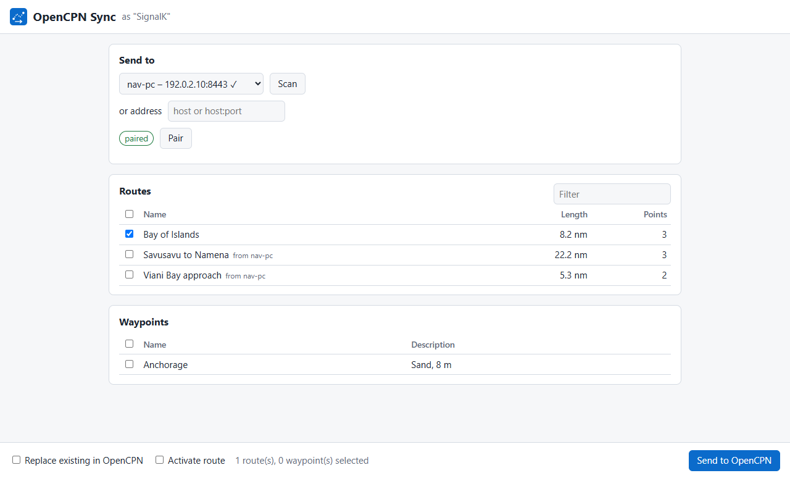
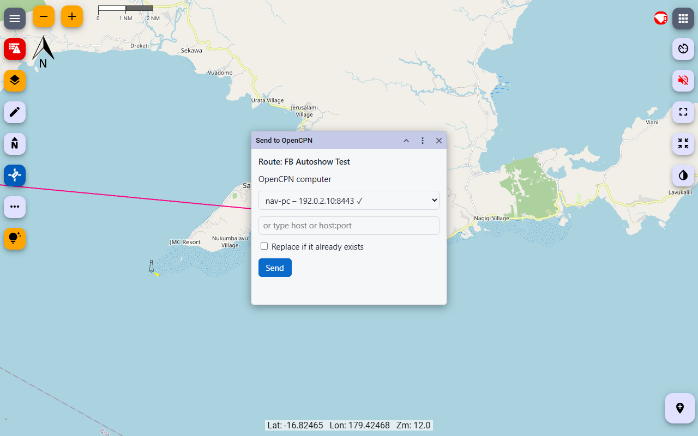

# signalk-opencpn-sync

A [Signal K](https://signalk.org) server plugin that exchanges routes and
waypoints with [OpenCPN](https://opencpn.org) over OpenCPN's own
**Send to Peer** protocol, in both directions:

- **OpenCPN → Signal K:** routes and waypoints sent from OpenCPN are stored as
  Signal K resources, so they show up in Freeboard-SK and every other app that
  uses the Resources API.
- **Signal K → OpenCPN:** pick routes and waypoints in the plugin's webapp, or
  trigger a transfer through its API, and they arrive in OpenCPN as if another
  OpenCPN had sent them.

To OpenCPN, the plugin looks like another OpenCPN instance on the network: it
answers and sends OpenCPN's peer discovery, pairs with a PIN like OpenCPN
does, and speaks its REST interface.



## Requirements

- Signal K server 2.x with a resources provider for `routes` and `waypoints`
  (the bundled **Resources Provider** plugin is enough).
- OpenCPN 5.8 or later. Tested with OpenCPN 5.15.0.
- TCP port **8443** free on the Signal K host and reachable from the OpenCPN
  computer. OpenCPN always sends to port 8443; it cannot be changed on the
  OpenCPN side.
- For discovery with **Scan**: UDP multicast (mDNS, port 5353) between both
  computers. A server in a container needs host networking for that.
  Without discovery you can type the server's IP address instead.

## Setup

1. Install the plugin from the Signal K App Store and enable it.
2. Make sure the Resources Provider plugin is enabled for routes and waypoints.

### Settings

| Setting | Default | Meaning |
|---|---|---|
| HTTPS port | 8443 | Port the plugin listens on. OpenCPN only uses 8443; change it for testing only. |
| Bind address | empty | IP address to listen on. Empty means all interfaces. |
| Peer name | `SignalK` | Name shown in OpenCPN's peer list. Must not start with `Portable`. |
| Announce via mDNS | on | Lets OpenCPN find the server with **Scan**. |
| Require PIN pairing | on | Off accepts routes from anyone on the network without a PIN. |
| Freeboard-SK extension | on | Show received routes and waypoints in Freeboard-SK and add "Send to OpenCPN" to its menu (see below). |
| OpenCPN computers to send to | empty | Extra addresses (`host` or `host:port`) offered for sending, besides those found on the network. |

## Sending a route from OpenCPN

1. In OpenCPN, right-click a route (or select it in the Route & Mark Manager)
   and choose **Send to Peer**.
2. Pick the Signal K server from the list after **Scan**, or type its IP
   address into the peer field.
3. Click **Send**. The first time, OpenCPN asks for a PIN. The plugin shows it
   as a Signal K notification (`notifications.opencpnSync.pairing`, visible in
   Freeboard-SK) and in the plugin status in the server's admin UI. Enter it in
   OpenCPN. Pairing is remembered per OpenCPN computer.
4. The route appears in Freeboard-SK under **Routes**.

Sending the same route again replaces it: OpenCPN asks whether to overwrite,
and the route keeps its id.

## Sending a route to OpenCPN

1. Open **OpenCPN Sync** from the server's **Webapps** page.
2. Choose the OpenCPN computer. **Scan** finds OpenCPN instances on the
   network; you can also type an address.
3. Tick the routes and waypoints to send and click **Send to OpenCPN**.
4. The first time, OpenCPN shows a PIN on its screen. Enter it in the webapp
   and send again. Pairing is remembered per OpenCPN computer.

Options:

- **Replace existing in OpenCPN** overwrites objects OpenCPN already has
  without asking. Without it, OpenCPN shows "The received route already
  exists on this system. Replace?" on its own screen. (OpenCPN is meant to
  report existing objects beforehand through `/api/writable`, but up to at
  least 5.15 that check always answers "writable", so the question appears
  in OpenCPN instead. If nobody answers within 10 seconds, the webapp reports
  the transfer as unconfirmed.)
- **Activate route** makes OpenCPN navigate the route at once (one route,
  OpenCPN 5.9 or later).

A route that came from OpenCPN goes back under its original GUID, so OpenCPN
replaces it instead of adding a copy. Routes made in Signal K use their
resource id as GUID, so sending them again replaces them too.

### API

Other apps (for example a Freeboard-SK extension) can start a transfer in two
ways. Both answer with the same outcome object:

| `status` | Meaning |
|---|---|
| `sent` | Transfer done (`count` objects). |
| `needsPin` | OpenCPN now shows a PIN; pair with it, then send again. |
| `exists` | Objects already exist in OpenCPN (`guids`); send again with `force`. |
| `error` | `code` and `message` say why (`unreachable`, `badRequest`, `unconfirmed`, …). |

**REST**, under `/plugins/signalk-opencpn-sync`. Sending and pairing need
read/write access (on servers before 2.35, admin):

| Endpoint | Body |
|---|---|
| `GET /api/peers` | – lists known OpenCPN computers and whether they are paired |
| `POST /api/scan` | – searches the network, then lists |
| `POST /api/pair` | `{"peer": "…", "pin": "1234"}`; without `pin` OpenCPN is asked to show one |
| `POST /api/send` | `{"peer": "…", "items": [{"type": "routes", "id": "…"}], "force": false, "activate": false}` |
| `POST /api/unpair` | `{"peer": "…"}` (admin) |

`peer` is `host` or `host:port` (port 8443 if left out) and may be omitted
when only one OpenCPN is known. Instead of `items`, a single `"type"` and
`"id"` is accepted.

**Signal K PUT**, for apps that already use PUT:

```
PUT /signalk/v1/api/vessels/self/opencpnSync/send
{"value": {"type": "routes", "id": "…", "peer": "…", "force": false}}

PUT /signalk/v1/api/vessels/self/opencpnSync/pair
{"value": {"peer": "…", "pin": "1234"}}
```

The request completes with `statusCode` 200 (sent or paired), 403 (PIN
needed or wrong), 409 (exists), 400, 502 or 504, and the outcome object as
JSON in `message`.

## Freeboard-SK

With Freeboard-SK 3.4 or later, the plugin registers itself as a Freeboard-SK
*plotter extension* (setting **Freeboard-SK extension**, on by default):

- **Received routes and waypoints appear on the chart.** When they arrive
  from OpenCPN, every open Freeboard-SK shows them at once, as if you had
  ticked them in the route or waypoint list; everything else stays as it was.
  A Freeboard-SK opened later shows what was received in the last 24 hours.
  Each browser shows an object only once, so hiding it again sticks.
  Waypoints need Freeboard-SK 3.5 or later; before that only routes are shown
  automatically.
- **"Send to OpenCPN" in the menu** of a route or waypoint on the chart. It
  opens a small window to pick the OpenCPN computer, pair with its PIN if
  needed, and send.



After turning the extension on (or installing the plugin), restart the Signal K
server once: Freeboard-SK only learns about extensions that were there when the
server started.

How it works: Freeboard-SK loads a hidden page of the plugin in every open
tab. That page opens a WebSocket to the plugin
(`/plugins/signalk-opencpn-sync/fb-bridge`), and the plugin tells it which
routes and waypoints to show; the page shows them through Freeboard-SK's
`resources.show` (3.5 and later) or `route.show`. The WebSocket only carries
route and waypoint ids from the plugin to the page.

## What is converted

| OpenCPN | Signal K |
|---|---|
| Route | `routes` resource: name, description, distance, point names in `feature.properties.coordinatesMeta` |
| Stand-alone waypoint / mark | `waypoints` resource: name, description, symbol in `feature.properties.sym` |
| Track | ignored (not supported yet) |

Sending to OpenCPN writes OpenCPN's own GPX form: route points get names from
`coordinatesMeta` (or `001`, `002`, …) and stable GUIDs derived from the
route.

Each resource carries `feature.properties.opencpnSync` with the sender's host
name, the time it was received and the OpenCPN GUID. The OpenCPN GUID is used
as the resource id, so resending replaces the same resource.

**Activate route** in OpenCPN's dialog is ignored for now.

## Security

- The plugin speaks HTTPS with a self-signed certificate, created once and kept
  in the plugin's data directory. OpenCPN does not check certificates.
- Senders must pair with a 4-digit PIN, the same scheme OpenCPN uses. The PIN
  is only shown on the Signal K side. After 20 failed attempts within a minute,
  pairing is locked for a minute.
- Keys of OpenCPN computers that send to Signal K are stored in
  `paired-keys.json`, keys for sending to OpenCPN in `peer-keys.json`, both in
  the plugin's data directory. Delete an entry there to unpair a computer.

## How it works

The plugin implements both sides of OpenCPN's REST interface
(`model/src/rest_server.cpp` and `model/src/peer_client.cpp` in the OpenCPN
sources). Receiving:

| Endpoint | Purpose |
|---|---|
| `GET /api/get-version` | Reports an OpenCPN version, so the sender uses the current pairing scheme. |
| `GET /api/ping` | Pairing and key check. |
| `GET /api/writable?guid=` | Tells the sender whether an object already exists. |
| `POST /api/rx_object` | Receives the GPX. |

Discovery answers and sends mDNS queries for
`opencpn-object-control-service`, the non-standard service name OpenCPN uses.

OpenCPN's server answers only one request per connection, so the client opens
a new connection for every request. OpenCPN waits up to 10 seconds for its own
user interface; if a dialog is open there, it answers "unconfirmed" and the
transfer may still complete once the dialog is closed.

## Development

```bash
npm install
npm test          # unit tests (vitest)
npm run typecheck
npm run build     # compiles to dist/
```

To try it against a local Signal K server, link the plugin directory into the
server's configuration directory (`node_modules/signalk-opencpn-sync`), enable
it, and send from OpenCPN. If OpenCPN runs on the same computer, it already
uses port 8443; set **Bind address** to `127.0.0.2` and type `127.0.0.2` as the
peer in OpenCPN.

### Releasing

Releases are made by [release-please](https://github.com/googleapis/release-please):
merging changes with Conventional Commit titles into `main` keeps a release
PR open; merging that PR tags the version, writes `CHANGELOG.md` and creates
the GitHub release. The same workflow then publishes to npm through trusted
publishing (OIDC, with provenance) once the repository variable
`NPM_TRUSTED_PUBLISHING` is `true`. The first version is published by hand,
because npm only accepts a trusted publisher for a package that already exists.

## License

MIT
